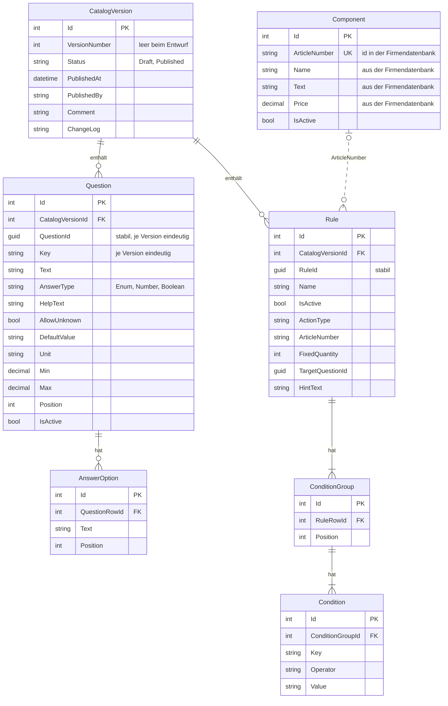
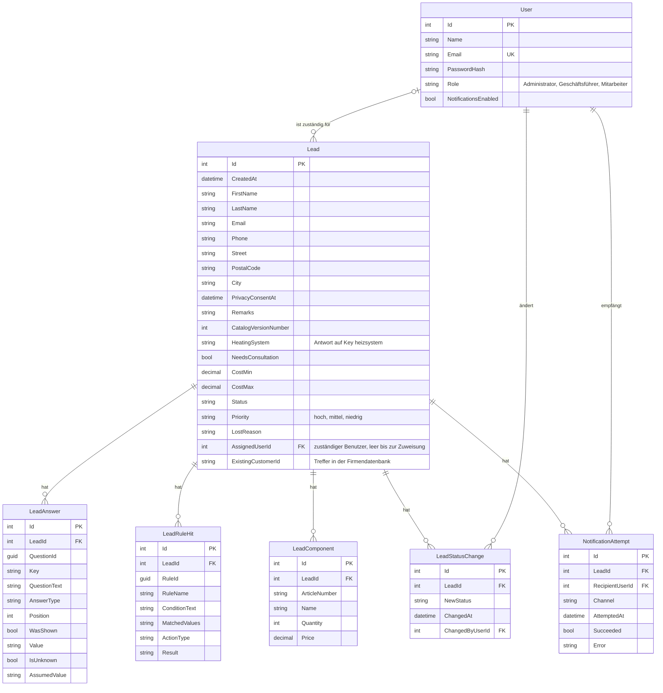

# ERD: Heizungskonfigurator
Version: 0.1.0  
Datum: 25.11.2026  
Autor(en): Geßwagner David, Tauschek Stefan, Weißenhofer Moritz, Wiesner Felix  
Auftraggeber: Tauschek Sanitär Heizung GmbH  
Grundlage: `Solution_Design.md` v0.4.0, `Anforderungen.md` v0.6.0, `Fachliches_Konzept.md` v0.6.0

Jede Anwendung hat ihre eigene Datenbank. Beziehungen zwischen den beiden Datenbanken gibt es nicht; der Heizungskonfigurator übergibt Leads über die API an das Backend der Verwaltungsapp.

## 1. Datenbank des Heizungskonfigurators

- `ArticleNumber`, `Name`, `Text` und `Price` werden über die API aus der Firmendatenbank übernommen; `IsActive` wird in der Verwaltungsapp gepflegt.
- `Rule.ArticleNumber` verweist auf `Component.ArticleNumber`. Die automatische Prüfung vor dem Veröffentlichen stellt sicher, dass der Baustein vorhanden und aktiv ist.
- `Condition.Key` verweist auf den `Key` einer Frage derselben Version, `Rule.TargetQuestionId` auf deren stabile `QuestionId`. Diese Verweise werden beim Prüfen kontrolliert, nicht über Fremdschlüssel.
- `PublishedBy` speichert den Benutzer als Text, weil die Benutzer in der LeadDB liegen.

## 2. LeadDB (Verwaltungsapp)

- Die Lead-Tabellen speichern Fragen, Antworten, Regeln und Bausteine als Kopie zum Anfragezeitpunkt. `QuestionId`, `RuleId` und `ArticleNumber` sind deshalb keine Fremdschlüssel.
- Das PDF wird nicht gespeichert, sondern bei Bedarf aus den Daten des Leads erzeugt.
- Die Status-Werte sind vorläufig (siehe `Fachliches_Konzept.md`, „Leadverwaltung“).
